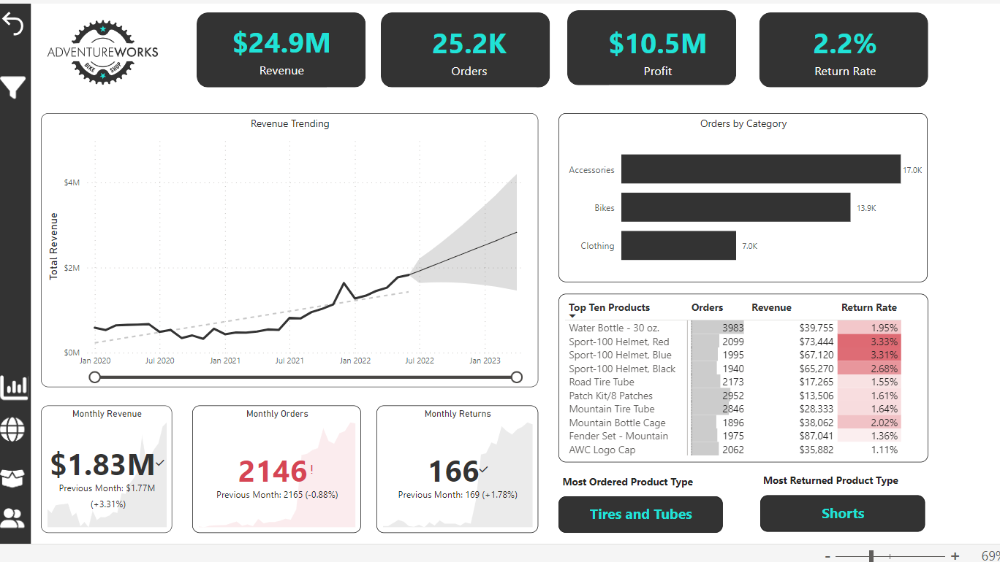

# Power BI Report: AdventureWorks Sales

An interactive Power BI report on sales for AdventureWorks, a fictional bike and outdoor-equipment company. It takes a reader from a high-level executive view down to individual products, customers and regions, and uses Power BI's AI visuals to explain what drives the numbers.

The report is in [`adventureworks_report.pbix`](adventureworks_report.pbix). Open it in [Power BI Desktop](https://www.microsoft.com/power-platform/products/power-bi/desktop) (free, Windows).

## Report pages

| Page | What it shows |
| --- | --- |
| **Exec Dashboard** | Headline KPIs for revenue, profit, orders and returns, compared with the previous month, plus trends over time |
| **Product Detail** | Drill-down for a selected product: performance against monthly order and profit targets, and a what-if price adjustment showing the effect on profit |
| **Customer Detail** | Customer segments by income level, occupation and other attributes, with average revenue per customer and top customers |
| **Map** | Orders and revenue by country and continent |
| **Decomposition Tree** | Breaks a metric down across product, customer and geography to find where results come from |
| **Key Influencers** | AI visual that ranks the customer attributes most associated with an outcome |
| **Q&A** | Lets the reader ask questions about the data in plain language |
| **Category Tooltip** | Custom tooltip page shown when hovering over product categories |

Navigation buttons with icons move between the main pages.

## Techniques used

- **Data model:** a star schema with `Sales Data` (and returns) as facts and lookup tables for calendar, customers, products, subcategories, categories and territories, plus a dedicated measure table.
- **DAX measures:** totals, rates and averages, previous-month comparisons, target gaps and adjusted profit.
- **What-if parameter:** `Price Adjustment (%)` recalculates profit for a hypothetical price change.
- **Field parameters:** `Product Metric Selection` and `Customer Metric Selection` let the reader switch which metric a chart shows.
- **Visuals:** KPI cards and gauges, line, area, bar and donut charts, matrix and tables, a map, slicers and anomaly detection on a time series.
- **AI visuals:** Key Influencers, Decomposition Tree and Q&A.

## How to explore the file

1. Open `adventureworks_report.pbix` in Power BI Desktop.
2. Start on **Exec Dashboard** and use the navigation buttons to move between pages.
3. On **Product Detail**, change the price adjustment slider to see the effect on profit.
4. Use **Model view** to inspect the tables and relationships, and the measure table for the DAX.

## Data source

The report uses Microsoft's AdventureWorks sample data. I built it while following the Power BI course from [Maven Analytics](https://mavenanalytics.io/).
